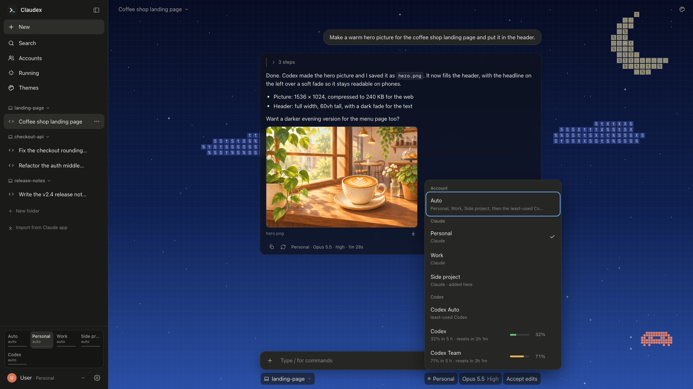

# Stop arguing Claude vs Codex. Use both.

Every week there is a new thread. Claude Code or Codex? Someone posts a comparison, someone else posts the opposite, and half the replies say they switched camps last month and are switching back.

Here is the thing nobody in those threads says out loud: you don't have to pick a side. Both are command-line tools that run on your computer, and nothing stops you from using both. The only thing in the way is that they live in two different places.

So I built Claudex, and today it's open source.



## The argument, fairly

Both tools are good, and they are not the same. They feel different to work with, they handle some jobs differently, and many people end up with a favourite for a given kind of task. I'm not going to pretend I have a benchmark that settles it, and I'm not going to name a winner. Those results change with every release anyway.

What I do know is how people actually work. They reach for one tool for one job and the other for the next. Or they get an answer from one and want a second opinion from the other. That is a sensible way to work. It is also awkward, because it usually means two terminals, two histories and a lot of copy and paste.

The question stops being "which is better?" and becomes "why can't I just use the right one for the job?"

## What Claudex is

Claudex is a web version of the Claude desktop app's Code tab. It runs on your own computer, and you use it from a browser: on the same machine, or on your phone.

There is no model call inside it and no API proxy. Each chat runs the real CLIs in a working folder on your machine. Claude Code jobs run as `claude -p`, with `--resume` for later turns. Codex jobs run as `codex exec --json`, with `codex exec resume` for later turns. The server is a small Node app with no dependencies, plus one plain HTML and JS page.

It is not a new coding agent. It is one window onto the two you already use.

## Both, in one place

**Pick per chat.** Under the composer there is an account chip, plus chips for model, effort, working folder and permission mode (plan, accept edits, auto, bypass). Choose a Claude account or a Codex account for each chat.

**Switch mid-conversation.** A chat is not locked to the engine that started it. Move it to another account, or to the other engine, and Claudex carries the session across, or sends a recap when the engines differ. You keep the thread instead of starting over.

**Pictures through Codex.** Claude has no image tool of its own, but Codex does. Claudex tells a Claude job it can hand picture work to Codex, and when the picture is ready, it shows up right in the chat. Any picture, video or sound file that a reply names by its full path appears under that reply.

**Several accounts of each.** Open **Accounts** in the sidebar and choose **+ Add account**. Name it, pick Claude or Codex, then sign in with a link and a short code. That works from any device, including your phone. On a Mac you can choose **Sign in with Terminal** instead. The account menu lists each login, and Codex accounts show usage bars and reset times.

These are **your own** accounts, for example a personal login and a work login. Each provider's terms apply, so follow them for every account you connect.

## A day with both

Here is what the workflow looks like in practice.

1. **Start the feature on Claude.** Open a chat in your project folder, pick a Claude account, and describe what you want. It reads the code and makes the change.
2. **Ask Codex for a second pass.** Same chat. Switch the account chip to a Codex account and ask it to review what was just done. Claudex carries the session over, or sends a recap, so Codex isn't starting cold.
3. **Go back if you want.** Switch to Claude again and let it act on the review.
4. **Need artwork?** Ask for a picture, such as an icon or a banner. Claude hands the job to Codex's image generation, and the result appears in the chat.

You didn't change apps, copy a diff or re-explain the project.

(One note: in accept-edits mode a headless Claude job can't run Bash, so the picture hand-off works in auto or bypass mode, or when that account's Claude settings allow Bash.)

## Your tools come along

Because Claudex runs the real CLIs, your skills, plugins and MCP servers still work. Jobs on an added Claude account use your usual `~/.claude` setup. A new Codex account starts with a copy of your main `config.toml`, so your MCP servers carry over.

## Themes and settings

A tool you live in should look the way you like. Each chat can have its own live, animated ASCII wallpaper: night sky, rain, aurora, code rain, sakura, snowfall, fireflies, night ocean and more, or Plain. There is a text size setting from small to huge, and voice input through your browser's own speech recognition, with an optional hands-free mode.

A few more things that make it feel like a real app:

- **Queued follow-ups.** Send while a reply is still running. It goes out when the reply finishes, or tap "Send now".
- **One-tap compaction.** A ring shows how full the conversation is. Tap it to summarise and start fresh from the summary.
- **Push notifications**, such as "this account is available again". Android Chrome, or iPhone once Claudex is on the Home Screen.
- **Import from the Claude desktop app**, which carries on here as a branch.
- **Save a chat as Markdown**, and press `?` for the shortcuts card.
- **A drive-space guard** that refuses jobs on a drive with less than 5 GB free.
- **Privacy masking** of your home folder, drive names and nicknamed folders before anything reaches the browser.

## Setup

The quickest way is to let Claude do it.

**Step 1.** Clone the repo and open it in Claude Code:

```sh
git clone https://github.com/ruxeu/claudex claudex
cd claudex
claude
```

**Step 2.** Say: *"set up Claudex for me."* The repo's `CLAUDE.md` walks it through the steps with you, and it never touches your existing logins.

**Step 3.** Open `http://127.0.0.1:5750`. On the same computer there is no sign-in.

By hand, it is:

```sh
cp config.example.json config.json   # then edit it
node tools/doctor.js                 # checks Node, the CLIs, the config and the port; changes nothing
node server.js
```

You need Node.js 20 or newer, and the Claude Code CLI, the Codex CLI, or both, already signed in. macOS is the main target, and Linux mostly works.

For your phone, add a Cloudflare Tunnel and Google sign-in through Firebase. Both have free tiers, and the README walks through every step.

## Security, briefly

**Claudex is a remote shell.** Anyone who gets past its door can run commands on your computer as your user.

- **Keep the sign-in list tight.** Use exact email addresses in `signIn.emails`. If both lists are empty, nobody gets in from the web.
- **Expose it only through Cloudflare Tunnel.** The server listens only on `127.0.0.1`. Never bind it to `0.0.0.0` or forward its port.
- **Every request is checked** for a custom header, a matching Origin and a matching Host, which stops other websites and DNS-rebinding tricks from driving it.
- **Google tokens are verified on the server**, then you get a signed, HttpOnly cookie.
- **Choose permission modes on purpose.** New chats start in accept-edits. Bypass means no questions asked.

The README has the full list.

## Try it

Pick a side if you like. Or don't.

- Star the repo so you can find it again.
- Clone it and say "set up Claudex for me".
- Open an issue for bugs, ideas or setup trouble. Pull requests are welcome.
- If you find a way past the sign-in or Host checks, please report it privately first.

**https://github.com/ruxeu/claudex**

MIT licensed. Your accounts, your machine, both engines.
